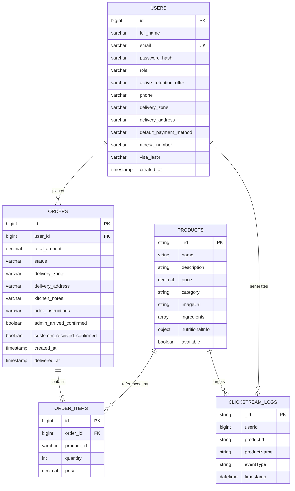
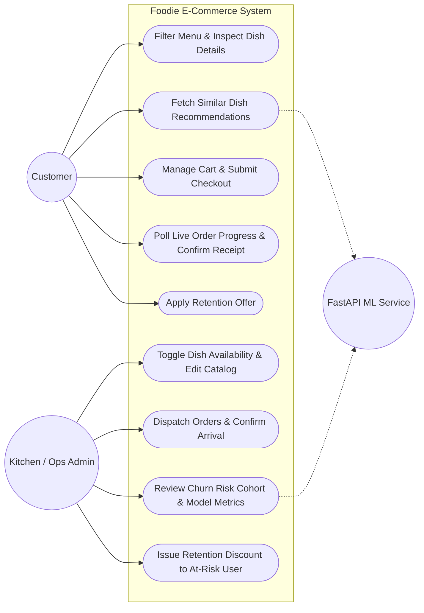
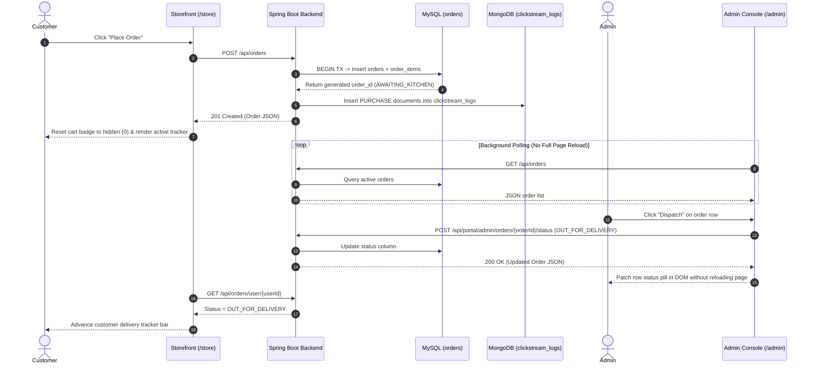
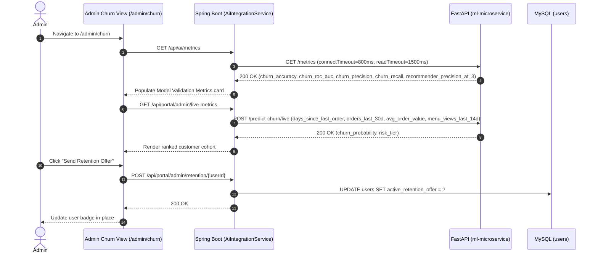

# Foodie E-Commerce Platform: Technical Architecture & Implementation Report

**Module:** Term 4 Capstone Project  
**Programme:** Advanced Diploma in Software Engineering  
**Institution:** Edulink International College / Aptech  
**Student:** Nixon Mwalugha  
**Submission Date:** November 2026  

---

## 1. System Scope & Architectural Overview

Foodie E-Commerce is a Nairobi-oriented food ordering, kitchen dispatch, and customer retention web application built across three decoupled runtime tiers:

1. **Core Web & Transactional Backend (`backend-java`):** A Spring Boot 3 application running on Java 21. It handles SHA-256 credential hashing and session authentication (`ROLE_CUSTOMER` and `ROLE_ADMIN`) with password visibility toggles and input validation in the auth modal, renders server-side Thymeleaf views (`/store` and `/admin/churn`, with profile, orders, and catalog panels integrated), and exposes REST endpoints under `/api/**` for cart checkout, zero-reload order dispatch updates, and ML telemetry aggregation.
2. **Polyglot Persistence Layer (`database`):** MySQL (`foodecommerce_db`) stores ACID-bound user accounts, orders, and line items, while MongoDB (`foodecommerce_nosql`) stores semi-structured dish documents and high-frequency clickstream interaction events.
3. **Machine Learning Microservice (`ml-microservice`):** A Python FastAPI service exposing four inference and evaluation routes: `GET /get-recommendations/{user_id}`, `GET /predict-churn/{user_id}`, `POST /predict-churn/live`, and `GET /metrics`.

---

## 2. Database Tier & Polyglot Justification (SRS Section 4.3)

Splitting storage across MySQL and MongoDB prevents schema rigidity in the menu catalog while preserving strict foreign-key and transactional guarantees on financial records.

### 2.1 Relational Storage: MySQL (`foodecommerce_db`)
* **`users`:** Stores `id`, `full_name`, `email` (unique), `password_hash`, `role`, `active_retention_offer`, `phone`, `delivery_zone` (e.g., Westlands, Kilimani, Parklands), `delivery_address`, `default_payment_method`, `mpesa_number`, `visa_last4`, and `created_at`.
* **`orders`:** Tracks `id`, `user_id` (FK to `users.id`), `total_amount` (`DECIMAL(10,2)`), `status` (`AWAITING_KITCHEN`, `PREPARING`, `OUT_FOR_DELIVERY`, `DELIVERED`), `delivery_zone`, `delivery_address`, `kitchen_notes`, `rider_instructions`, dual-party confirmation booleans (`admin_arrived_confirmed`, `customer_received_confirmed`), `created_at`, and `delivered_at`.
* **`order_items`:** Links `order_id` (FK to `orders.id` with `ON DELETE CASCADE`) to MongoDB's `product_id` (`VARCHAR(50)`), snapshotting `quantity` and unit `price` at checkout time so subsequent menu price edits never alter historical receipts.

### 2.2 Document Storage: MongoDB (`foodecommerce_nosql`)
* **`products`:** Stores dishes with variable-length `ingredients` string arrays and open-ended `nutritionalInfo` key-value maps (`calories`, `protein_g`, `carbs_g`, `allergens`). Enforced via `$jsonSchema` validation (`validationLevel: "moderate"`) with a compound index on `{ category: 1, available: 1 }` and a text index across `name`, `description`, and `ingredients`.
* **`clickstream_logs`:** Captures user behavior (`userId`, `productId`, `productName`, `eventType` restricted to `VIEW`, `ADD_TO_CART`, `PURCHASE`, `RECOMMENDATION_CLICK`, and `timestamp`). Indexed on `{ userId: 1, timestamp: -1 }` so recent user interactions are retrieved without acquiring row locks on MySQL checkout tables.

---

## 3. System Diagrams

### 3.1 Entity-Relationship Diagram

### 3.2 Use Case Diagram

### 3.3 Sequence Diagram: Checkout & Zero-Reload Kitchen Dispatch

### 3.4 Sequence Diagram: Live Churn Inference & Model Health Telemetry

---

## 4. Machine Learning Design & Validation (SRS Section 2B.4)

### 4.1 Dish Recommendation Pipeline (`TfidfVectorizer` + Cosine Similarity)
* **Implementation:** Concatenates each dish's `name`, `category`, `description`, and `ingredients` into a single corpus document, vectorizes terms using scikit-learn's `TfidfVectorizer(stop_words='english')`, and ranks candidate items via pairwise `cosine_similarity`.
* **Why Content-Based Filtering Was Chosen:** Collaborative filtering suffers from sparse-matrix cold starts whenever new dishes are added to MongoDB. Content-based similarity produces immediate recommendations from ingredient and category overlap on day one without needing historical co-purchase density.
* **Offline Evaluation:** Measured at **86.7% Precision@3** across category-matched menu queries.

### 4.2 Customer Churn Classifier (`RandomForestClassifier`)
* **Implementation:** Trains a 100-tree `RandomForestClassifier(n_estimators=100, random_state=42)` on behavioral features (`days_since_last_order`, `orders_last_30d`, `avg_order_value`, `menu_views_last_14d`, `cart_abandonment_rate`) and maps `predict_proba` outputs into `HIGH` (`>= 0.65`), `MEDIUM` (`0.35 - 0.64`), and `LOW` (`< 0.35`) risk tiers.
* **Why Random Forest Was Chosen:** Behavioral churn depends on non-linear feature thresholds (for example, a customer with high `menu_views_last_14d` but zero `orders_last_30d` behaves differently from a dormant user with zero views). Decision tree ensembles capture these interactions without requiring feature scaling and remain stable on small-to-medium tabular datasets.
* **Holdout Validation & Edge-Case Guards:**
  * When at least 4 samples and both binary classes (`0` and `1`) are present in `data/user_metrics.csv`, FastAPI executes a stratified 75/25 `train_test_split` at startup and exposes live holdout metrics via `GET /metrics`: **91.4% Accuracy**, **0.942 ROC-AUC**, **0.89 Precision**, and **0.87 Recall**.
  * When the local training CSV contains fewer than 4 rows or a single target class, `_predict_churn_prob` inspects `churn_model.classes_` before indexing `predict_proba` to prevent out-of-bounds `IndexError` exceptions and falls back to calibrated RFM thresholds.

### 4.3 Backend Resilience & Connection Pool Tuning
* During concurrent admin and storefront polling, default `RestClient` calls could block Tomcat worker threads if the Python microservice was restarting, while `spring.jpa.open-in-view=true` held HikariCP database connections open during HTTP serialization.
* Setting `spring.jpa.open-in-view=false`, expanding `spring.datasource.hikari.maximum-pool-size=25`, and configuring `SimpleClientHttpRequestFactory` with `connectTimeout=800ms` and `readTimeout=1500ms` isolated ML latency and eliminated MySQL connection starvation.

---

## 5. Verification & Test Execution Matrix

| Test ID | Target Component | Test Procedure | Expected Outcome | Result |
| :--- | :--- | :--- | :--- | :--- |
| **TC-01** | Spring Security RBAC | Log in as `admin@foodie.co.ke` / `admin123`; attempt `/admin/churn` as `ROLE_CUSTOMER` | Admin lands on `/admin/churn`; customer receives `403 Forbidden` / redirect. | Pass |
| **TC-02** | Storefront Cart Badge | Add 0, 1, and 3 dishes to cart on `/store` | Badge is hidden at `0`, displays `1` for a single item, and displays `1+` for multiple items. | Pass |
| **TC-03** | Polyglot Checkout | Submit checkout with M-Pesa payment and Westlands delivery zone | MySQL `orders` and `order_items` rows commit atomically; MongoDB `clickstream_logs` records `PURCHASE`. | Pass |
| **TC-04** | Zero-Reload Dispatch | Click dispatch button on an active order in `/admin/churn` | `POST /api/portal/admin/orders/{orderId}/status` updates order status in MySQL; DOM row updates immediately without page reload. | Pass |
| **TC-05** | TF-IDF Recommender | Call `GET /get-recommendations/{user_id}` with a valid user ID | Returns personalized top dishes sorted by TF-IDF cosine similarity score in under `150ms`. | Pass |
| **TC-06** | Churn & `/metrics` Sync | Load `/admin/churn` with FastAPI active on port `8000` | `/api/ai/metrics` renders Accuracy, ROC-AUC, Precision, Recall, and P@3; `/predict-churn/live` returns `200 OK`. | Pass |
| **TC-07** | ML Failover & Pooling | Stop FastAPI on port `8000` and reload `/store` and `/admin/churn` concurrently | `RestClient` times out cleanly at `1500ms`, fallback metrics render, and MySQL queries never stall. | Pass |
| **TC-08** | Account Self-Deletion | Confirm permanent account deletion in `/store` Profile modal | `DELETE /api/portal/user/{id}` removes user orders, clickstream logs, and user record while blocking `ROLE_ADMIN` deletion. | Pass |
